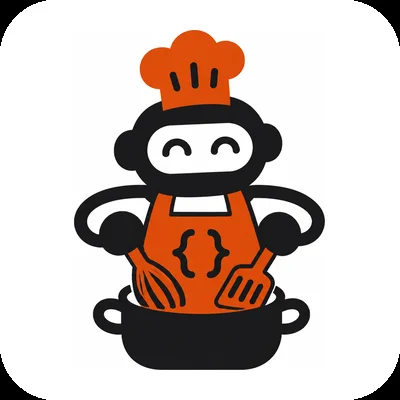
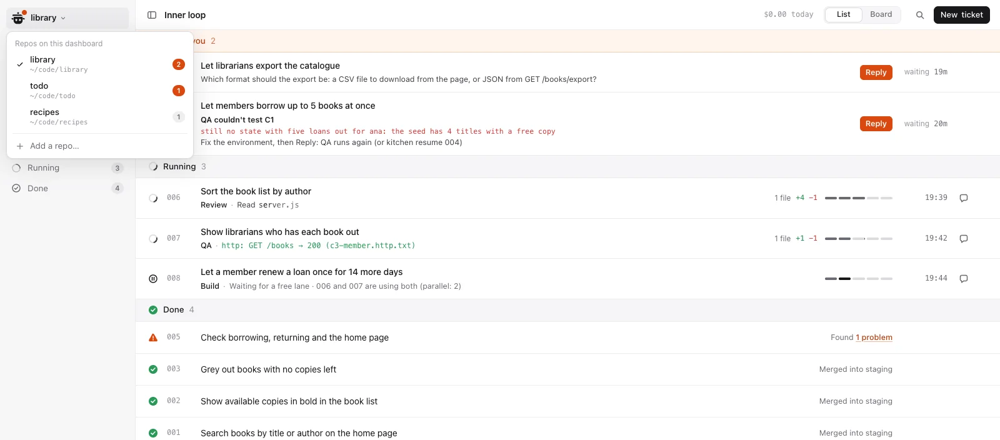

<p align="center"></p>

<p align="center">
<picture>
  <source media="(prefers-color-scheme: dark)" srcset="docs/img/logo-dark.svg">
  
</picture>
</p>

<p align="center"><b>Tickets in. Reviewed, tested changes on staging out.</b></p>

<picture>
  <source media="(prefers-color-scheme: dark)" srcset="docs/img/dashboard-board-dark.webp">
  
</picture>

One Claude Code session runs your queue: an agent per lane writes the criteria, builds, checks the running app in a real browser and reviews. Kitchen moves every job, re-runs your checks, drives the features a change touches on the merged result, and merges what passes into `staging`. You merge `staging` onward.

<p align="center"><a href="docs/video/kitchen.mp4"></a><br><sub><a href="docs/video/kitchen.mp4">▶ Watch Kitchen in under two minutes</a> (1:48, with voiceover)</sub></p>

> **Why I built it.** New branch. New Claude session. Same speech: here's how you run the server, here's the seed data, no, the other port. I gave that speech enough times that I automated it. Kitchen learns your app once and every agent after that just gets to work. Yes, I named it after food. I was hungry.

## Four steps

```sh
npm i -g devkitchen
```

### 1. Set it up

```sh
kitchen init
```

It checks what it needs, finds your checks and how to start your app, installs guard hooks into `.claude/settings.json`, creates a `staging` branch and runs your checks. It takes seconds.

<picture>
  <source media="(prefers-color-scheme: dark)" srcset="docs/img/term-init-dark.webp">
  
</picture>

### 2. Give it a ticket

```sh
kitchen ticket "<what you want>"
```

Plain words are enough. Intake turns them into criteria, or asks you one question.

<picture>
  <source media="(prefers-color-scheme: dark)" srcset="docs/img/term-ticket-dark.webp">
  
</picture>

### 3. Run the queue

In Claude Code, type `/kitchen run`. Or, from a terminal:

```sh
kitchen run --detach && kitchen dashboard
```

The session plans waves and starts one agent per lane. Tickets run side by side, even when they touch the same file: git merges them, and one that conflicts with what landed first **catches up**: its builder resolves the merge on top of `staging`, QA re-drives what passed, review reads only the resolution, and it costs no round. Answer a job that needs you, or steer one from the dashboard.

**One dashboard for every repo.** `kitchen dashboard` serves http://127.0.0.1:7357/ with a switcher for every repo you ran Kitchen in. Run it in another repo and it joins the open page (`already open: …/#<repo>`) instead of taking a new port; a badge counts jobs in other repos that need you.

<picture>
  <source media="(prefers-color-scheme: dark)" srcset="docs/img/dashboard-switcher-dark.webp">
  
</picture>

<picture>
  <source media="(prefers-color-scheme: dark)" srcset="docs/img/dashboard-panel-dark.webp">
  
</picture>

### 4. Read the Report, merge staging

```sh
git log staging
```

A job whose QA and review pass is merged into `staging`, after Kitchen runs your checks again on the merged result. High-risk jobs and big diffs stop at Ready for you. Kitchen never touches `main`.

<picture>
  <source media="(prefers-color-scheme: dark)" srcset="docs/img/report-dark.webp">
  
</picture>

## How it works

<picture>
  <source media="(prefers-color-scheme: dark)" srcset="docs/img/how-it-works-dark.svg">
  
</picture>

QA follows and keeps a **verify skill** in your repo (`.claude/skills/verify-<app>/`): one file per feature saying how to check it and which files are behind it. Before a job merges, a **merge check** drives every feature whose files the merge changes, on the merged result, so one job breaking another's feature goes back to Build instead of landing. More: [the verify map](docs/guide.md#the-verify-map).

## Why Kitchen

<table>
<tr>
<td width="33%" valign="top"><br><b>Checked in your running app</b><br>QA starts your app and checks each criterion: HTTP for APIs, a real browser (Playwright) with screenshots for pages.</td>
<td width="33%" valign="top"><br><b>Kitchen decides, not the agent</b><br>Jobs move only through Kitchen's verbs. Kitchen runs your checks itself and refuses a verdict without its evidence files.</td>
<td width="33%" valign="top"><br><b>Staging, never main</b><br>Passing work lands on <code>staging</code>, re-checked after the merge. Guard hooks refuse pushes to main and your base branch.</td>
</tr>
</table>

## Safety, plainly

Guard hooks (adapted from super-board) stop an agent from reading `.env` files and keys, writing a key into a file, pushing to `main` or your base branch, deleting outside the project, and writing outside its job's worktree. They stop accidents, not a determined or prompt-injected agent: lane agents run as you, in your Claude Code session, with your tools. There is no OS sandbox. Merges to `staging` happen without a person; `main` stays yours. More: [Safety model and limits](docs/safety.md).

## More

[Guide](docs/guide.md) · [A worked example](docs/guide.md#a-worked-example) · [Configuration](docs/configuration.md) · [Safety model and limits](docs/safety.md) · [Bench](bench/README.md) · [Release](docs/RELEASE.md) · `kitchen --help` · [Developing Kitchen](docs/guide.md#developing-kitchen)

<details>
<summary>Use it from Claude Code</summary>

```
/plugin marketplace add jcodebreaker/kitchen
/plugin install kitchen@kitchen
/kitchen:kitchen set up Kitchen
```

Plugin skills are namespaced, so the skill is `/kitchen:kitchen` (type `/kitchen` and pick it); `kitchen init` also installs it into the repo as `/kitchen`. Codex can file tickets and read status through the same skill; running the queue needs Claude Code (its Agent tool and hooks).

</details>

<details>
<summary>Role skills</summary>

`kitchen skills` lists the skills each lane can use. How they are found and used: [ADR 0014](docs/adr/0014-role-skills.md).

<!-- skills-registry:start (generated from skills/registry.json: npm run skills:readme) -->
| Role | Required | Picked by kind / surface / risk | Optional | Fallback if missing |
|---|---|---|---|---|
| intake | — | — | `domain-modeling` | the role prompt |
| builder | — | kind bug → `diagnosing-bugs`; kind feature/ui → `tdd`; kind chore → `codebase-design` | a registry skill named on the ticket's `Kitchen-Skills:` line (required) | the role prompt alone |
| qa | — | — | — | the roles/qa.md steps |
| reviewer-code | — | — | `code-review`, `codebase-design` | the roles/reviewer.md checklist |
| reviewer-security | `security-review` (high risk) | security surface → `security-review` | — | none needed: Kitchen ships it |
| reviewer-ui | — | ui surface → `impeccable` | — | the reviewer-ui.md rubric; the Report says degraded |

Never loaded: the interactive `grilling`, `grill-me`, `grill-with-docs`, `wizard`, `triage`, `ask-matt`, `to-questionnaire`, and any skill whose frontmatter says `disable-model-invocation: true`. Shipped with Kitchen (skills/vendor/, see NOTICE): `security-review`.
<!-- skills-registry:end -->

</details>

v0.1 · macOS and Linux · needs Claude Code to run the queue · Apache-2.0 · [Credits](NOTICE)
