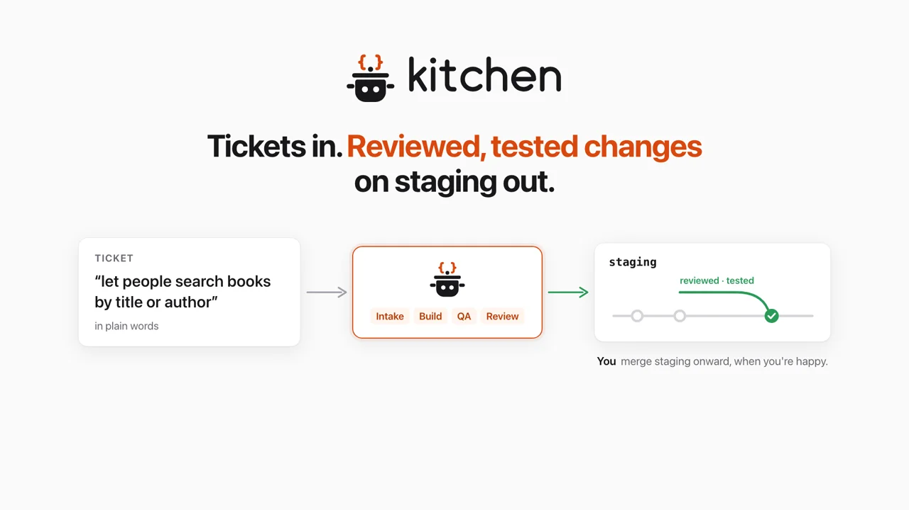
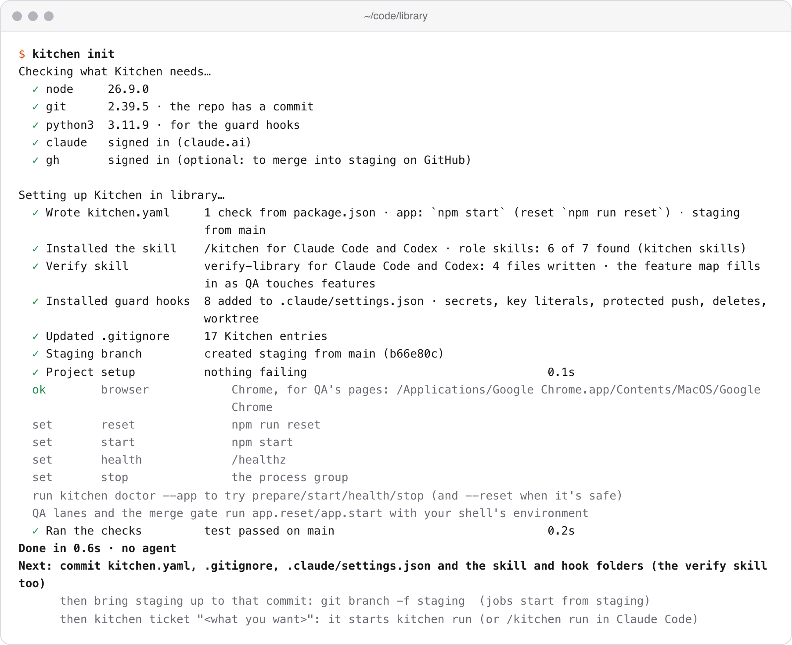
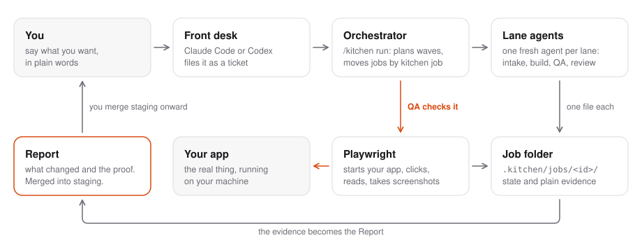

<p align="center"></p>

<p align="center">
<picture>
  <source media="(prefers-color-scheme: dark)" srcset="docs/img/logo-dark.svg">
  
</picture>
</p>

<p align="center"><b>Tickets in. Reviewed, tested changes on staging out.</b></p>

<picture>
  <source media="(prefers-color-scheme: dark)" srcset="docs/img/dashboard-board-dark.webp">
  
</picture>

`kitchen run` works your queue: one fresh Claude Code (or Codex) session per lane writes the criteria, builds, checks the running app in a real browser and reviews. Kitchen itself, plain code, moves every job, re-runs your checks, drives the features a change touches on the merged result, and merges what passes into `staging`. You merge `staging` onward.

<p align="center"><a href="docs/video/kitchen.mp4"></a><br><sub><a href="docs/video/kitchen.mp4">▶ Watch Kitchen in under two minutes</a> (1:48, with voiceover)</sub></p>

> **Why I built it.** New branch. New Claude session. Same speech: here's how you run the server, here's the seed data, no, the other port. I gave that speech enough times that I automated it. Kitchen learns your app once and every agent after that just gets to work. Yes, I named it after food. I was hungry.

## Five steps

Kitchen isn't on npm yet. Install it from source:

```sh
git clone https://github.com/jcodebreaker/kitchen.git && cd kitchen
npm ci && npm run build && npm link      # puts `kitchen` on your PATH
```

Once it is published, `npm i -g devkitchen` will do the same.

### 1. Set it up

```sh
kitchen init
```

It checks what it needs, finds your checks, your end-to-end suite (run on every merge into staging, against the app) and how to start your app, installs guard hooks into `.claude/settings.json`, creates a `staging` branch and runs your checks. It takes seconds and never starts your app: `kitchen doctor --app` tries that when you ask.

<picture>
  <source media="(prefers-color-scheme: dark)" srcset="docs/img/term-init-dark.webp">
  
</picture>

### 2. Commit the setup, bring staging up to it

```sh
git add kitchen.yaml .gitignore .claude .agents && git commit -m "Set up Kitchen"
git branch -f staging                    # on GitHub (forge github): git push origin HEAD:staging
```

Jobs start from `staging` (from `origin/staging` on GitHub), and that is where QA finds the verify skill, so the setup must be on it. `git branch -f` is safe now, while nothing has merged yet.

### 3. Give it a ticket

```sh
kitchen ticket "<what you want>"
```

Plain words are enough. Intake turns them into criteria, asks you one question, or, when the ticket can be read more than one way, asks you to refine it with it in Claude Code. Filing a ticket starts Kitchen (`kitchen run --detach`) when nothing works the queue yet; `--no-run` only files it.

To test something without changing code ("check checkout still works", "go through the loan flow and see what breaks"), file a check: QA drives staging as it is, nothing is built or merged, and the job ends "Checked on staging · 4 of 4 pass" or "Found 2 problems", each problem proposed in the inbox for you to run, hold or set aside.

```sh
kitchen ticket --check "check checkout still works"
kitchen ticket --check --every day "check checkout still works"    # on a timer; --every off "<same text>" removes it
kitchen schedules                                                  # this repo's timers
```

Code asked for only to verify something now ("a harness that proves the import handles 10k rows") is built and checked, then stops at Done, "Verified · not merged", its branch kept: `kitchen promote <id>` reviews and merges it later.

<picture>
  <source media="(prefers-color-scheme: dark)" srcset="docs/img/term-ticket-dark.webp">
  
</picture>

### 4. Run the queue

The ticket already started it. To start it by hand, or to watch:

```sh
kitchen run --detach      # the headless default; kitchen run --stop ends it
kitchen dashboard
```

Kitchen plans waves and starts one agent session per lane (`claude -p`, or `codex exec` with `agent.tool: codex`), finishing each lane the moment its agent ends, so a fast job never waits for a slow one. In Claude Code, `/kitchen run` works the queue in your session instead, so you can watch it. Tickets run side by side, even when they touch the same file: git merges them, and one that conflicts with what landed first **catches up**: its builder resolves the merge on top of `staging`, QA re-drives what passed, review reads only the resolution, and it costs no round. Answer a job that needs you, or steer one from the dashboard.

**One dashboard for every repo.** `kitchen dashboard` serves http://127.0.0.1:7357/ with a switcher for every repo you ran Kitchen in. Run it in another repo and it joins the open page (`already open: …/#<repo>`) instead of taking a new port; a badge counts jobs in other repos that need you. After Kitchen is rebuilt or updated, the page says so; `kitchen dashboard --restart` starts the new build on the same port.

<picture>
  <source media="(prefers-color-scheme: dark)" srcset="docs/img/dashboard-switcher-dark.webp">
  
</picture>

<picture>
  <source media="(prefers-color-scheme: dark)" srcset="docs/img/dashboard-panel-dark.webp">
  
</picture>

### 5. Read the Report, merge staging

```sh
git log staging          # on GitHub with staging.merge: pr, merge the PRs first, then git fetch and read origin/staging
```

A job whose QA and review pass is merged into `staging`, after Kitchen runs your checks again on the merged result. High-risk jobs and big diffs stop at Ready for you. Kitchen never touches `main`.

**Another target.** `kitchen ticket --into feature/checkout "…"` aims one job at an existing branch: its Build starts from that branch, its checks and merge check run on it, and it merges there. Staging is untouched.

**Who merges.** `staging.merge: kitchen` (the default for a local repo): Kitchen merges a passing job. `staging.merge: pr` (what `kitchen init` sets when origin is on GitHub): after the merge check passes, Kitchen pushes the job branch and opens a PR into the target with the Report as its body; the job waits under Needs you as "PR open · waiting for review" and a person merges it on GitHub, under your review, CI and branch protection. Kitchen sees it merged (Done) or closed (Rejected) within a minute, and re-runs the merge check when the target moves under an open PR. Rejecting or removing a job closes its open PR.

<picture>
  <source media="(prefers-color-scheme: dark)" srcset="docs/img/report-dark.webp">
  
</picture>

## How it works

<picture>
  <source media="(prefers-color-scheme: dark)" srcset="docs/img/how-it-works-dark.svg">
  
</picture>

QA follows and keeps a **verify skill** in your repo (`.claude/skills/verify-<app>/`): one file per feature saying how to check it and which files are behind it. A repo that ignores `.claude/` keeps it on your machine instead (`.kitchen/verify/skill/`, `verify.map: local` in kitchen.yaml): Kitchen copies it into each job and never commits it. Before a job merges, a **merge check** drives every feature whose files the merge changes, on the merged result, so one job breaking another's feature goes back to Build instead of landing. More: [the verify map](docs/guide.md#the-verify-map).

## Why Kitchen

<table>
<tr>
<td width="33%" valign="top"><br><b>Checked in your running app</b><br>QA starts your app and checks each criterion: HTTP for APIs, a real browser (Playwright) with screenshots for pages.</td>
<td width="33%" valign="top"><br><b>Kitchen decides, not the agent</b><br>Jobs move only through Kitchen's verbs. Kitchen runs your checks itself and refuses a verdict without its evidence files.</td>
<td width="33%" valign="top"><br><b>Staging, never main</b><br>Passing work lands on <code>staging</code>, re-checked after the merge. Guard hooks refuse pushes to main and your base branch.</td>
</tr>
</table>

## Safety, plainly

Guard hooks (adapted from super-board) stop a Claude lane from reading `.env` files and keys, writing a key into a file, pushing to `main` or your base branch, deleting outside the project, and writing outside its job's worktree. They stop accidents, not a determined or prompt-injected agent: Claude lanes run as you, with your shell, and there is no OS sandbox. Codex lanes run in Codex's `workspace-write` sandbox instead. Either way, your checks and your app run unsandboxed on the lane's code, with your environment. Merges to `staging` happen without a person (or through PRs a person merges, with `staging.merge: pr`); `main` stays yours. More: [Safety model and limits](docs/safety.md).

## More

[Guide](docs/guide.md) · [A worked example](docs/guide.md#a-worked-example) · [Configuration](docs/configuration.md) · [Safety model and limits](docs/safety.md) · [Bench](bench/README.md) · [Release](docs/RELEASE.md) · `kitchen --help` · [Developing Kitchen](docs/guide.md#developing-kitchen)

<details>
<summary>Use it from Claude Code</summary>

```
/plugin marketplace add jcodebreaker/kitchen
/plugin install kitchen@kitchen
/kitchen:kitchen set up Kitchen
```

Plugin skills are namespaced, so the skill is `/kitchen:kitchen` (type `/kitchen` and pick it); `kitchen init` also installs it into the repo as `/kitchen`. Codex uses the same skill (`kitchen:kitchen`): it files tickets and reads status, and `kitchen run` with `agent.tool: codex` runs the queue headless on `codex exec` (built and tested against stand-ins; not yet tried on a real Codex run).

</details>

<details>
<summary>Role skills</summary>

`kitchen skills` lists the skills each lane can use. How they are found and used: [ADR 0014](docs/adr/0014-role-skills.md).

<!-- skills-registry:start (generated from skills/registry.json: npm run skills:readme) -->
| Role | Required | Picked by kind / surface / risk | Optional | Fallback if missing |
|---|---|---|---|---|
| intake | — | — | `domain-modeling` | the role prompt |
| builder | — | kind bug → `diagnosing-bugs`; kind feature/ui → `tdd`; kind chore → `codebase-design` | a registry skill named on the ticket's `Kitchen-Skills:` line (required) | the role prompt alone |
| qa | — | — | — | the roles/qa.md steps |
| reviewer-code | — | — | `code-review`, `codebase-design` | the roles/reviewer.md checklist |
| reviewer-security | `security-review` (high risk) | security surface → `security-review` | — | none needed: Kitchen ships it |
| reviewer-ui | — | ui surface → `impeccable` | — | the reviewer-ui.md rubric; the Report says degraded |

Never loaded: the interactive `grilling`, `grill-me`, `grill-with-docs`, `wizard`, `triage`, `ask-matt`, `to-questionnaire`, and any skill whose frontmatter says `disable-model-invocation: true`. Shipped with Kitchen (skills/vendor/, see NOTICE): `security-review`.
<!-- skills-registry:end -->

</details>

v0.1 · macOS and Linux · runs the queue on Claude Code or Codex · Apache-2.0 · [Credits](NOTICE)
