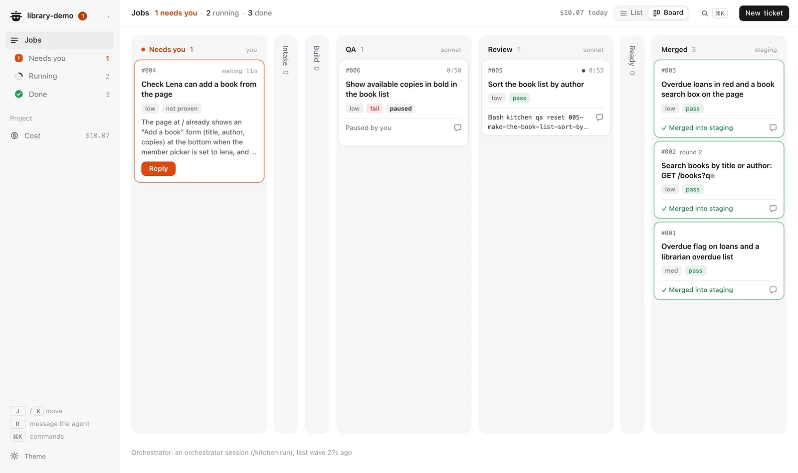
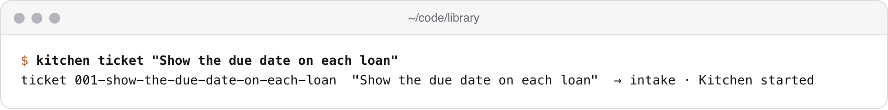

<p align="center"></p>

<p align="center">
<picture>
  <source media="(prefers-color-scheme: dark)" srcset="docs/img/logo-dark.svg">
  
</picture>
</p>

<p align="center"><b>Tickets in. Proven pull requests out.</b></p>

<picture>
  <source media="(prefers-color-scheme: dark)" srcset="docs/img/dashboard-board-dark.webp">
  
</picture>

Coding agents (Claude Code or Codex) write the code. Kitchen runs every proof itself and keeps the evidence. You merge.

> **Why I built it.** I'm a senior engineer, and I got tired of the same ritual: every new Claude session, every new branch, I spent ages rebuilding the test setup so the agent could actually try the feature. So I built my own factory and called it Kitchen, because I like food and I like my agents cooking. Kitchen learns how to run your app once, and every job after that reuses it.

## Four steps

```sh
npm i -g devkitchen
```

### 1. Set it up

```sh
kitchen init
```

It checks what it needs, finds your checks and runs them. It takes seconds.

<picture>
  <source media="(prefers-color-scheme: dark)" srcset="docs/img/term-init-dark.webp">
  
</picture>

### 2. Give it a ticket

```sh
kitchen ticket "<what you want>"
```

Plain words are enough.

<picture>
  <source media="(prefers-color-scheme: dark)" srcset="docs/img/term-ticket-dark.webp">
  
</picture>

### 3. Watch it work

```sh
kitchen run --detach && kitchen dashboard
```

Answer a job that needs you, or steer one while it runs.

<picture>
  <source media="(prefers-color-scheme: dark)" srcset="docs/img/dashboard-panel-dark.webp">
  
</picture>

### 4. Read the Report, then merge

```sh
git merge kitchen/<job id>
```

The Report shows what you must check, then the proof. Kitchen never merges.

<picture>
  <source media="(prefers-color-scheme: dark)" srcset="docs/img/report-dark.webp">
  
</picture>

### Have it drive your real app

```sh
kitchen toolkit build
```

Once, 3 to 15 minutes: an agent writes a Toolkit that starts and drives your app, and Kitchen proves it. Then one question: `Use this Toolkit to run your app for every job? [Y/n]`. Nothing is merged or committed. Without a Toolkit, jobs are proven by your checks and tests.

## How it works

<picture>
  <source media="(prefers-color-scheme: dark)" srcset="docs/img/how-it-works-dark.svg">
  
</picture>

## Why Kitchen

<table>
<tr>
<td width="33%" valign="top"><br><b>Proven in your app</b><br>With a Toolkit, Kitchen starts your real app and drives it against each acceptance criterion.</td>
<td width="33%" valign="top"><br><b>Evidence agents can't fake</b><br>Plain code runs each proof and signs the result. An agent's say-so decides nothing.</td>
<td width="33%" valign="top"><br><b>You merge</b><br>Agents hold no push rights and no tokens. A person reads the Report and merges.</td>
</tr>
</table>

## More

[Guide](docs/guide.md) · [A worked example](docs/guide.md#a-worked-example) · [Configuration](docs/configuration.md) · [Safety model and limits](docs/safety.md) · [Bench](bench/README.md) · [Release](docs/RELEASE.md) · `kitchen toolkit approve` · `kitchen --help` · [Developing Kitchen](docs/guide.md#developing-kitchen)

<details>
<summary>Use it from Claude Code or Codex</summary>

```
/plugin marketplace add jcodebreaker/kitchen
/plugin install kitchen@kitchen
/kitchen:kitchen set up Kitchen
```

Plugin skills are namespaced, so the skill is `/kitchen:kitchen` (type `/kitchen` and pick it). Codex: `codex plugin marketplace add jcodebreaker/kitchen`, then `codex plugin install kitchen@kitchen`; the skill is `kitchen:kitchen`.

</details>

<details>
<summary>Role skills</summary>

`kitchen skills` lists the skills each role can use. How they are found and used: [ADR 0014](docs/adr/0014-role-skills.md).

<!-- skills-registry:start (generated from skills/registry.json: npm run skills:readme) -->
| Role | Required | Picked by kind / surface / risk | Optional | Fallback if missing |
|---|---|---|---|---|
| builder | — | kind bug → `diagnosing-bugs`; kind feature/ui → `tdd`; kind chore → `codebase-design` | a registry skill named on the ticket's `Kitchen-Skills:` line (required) | the role prompt alone (today's behaviour) |
| intake | — | — | `domain-modeling` | the role prompt |
| spec | — | — | — | the role prompt |
| reviewer-code | — | — | `code-review`, `codebase-design` | the roles/_review.md checklist |
| reviewer-security | `security-review` (high risk) | security surface → `security-review` | — | none needed: Kitchen ships it |
| reviewer-ui | — | ui surface → `impeccable` | — | the reviewer-ui.md rubric; the Report says degraded |
| reviewer-ux | — | — | — | the role prompt |
| verifier | — | — | — | none: the verifier judges only what needs eyes |
| report | — | — | `humanizer` | the role prompt |

Never loaded: the interactive `grilling`, `grill-me`, `grill-with-docs`, `wizard`, `triage`, `ask-matt`, `to-questionnaire`, and any skill whose frontmatter says `disable-model-invocation: true`. Shipped with Kitchen (skills/vendor/, see NOTICE): `security-review`.
<!-- skills-registry:end -->

</details>

v0.1 · macOS (Linux runs without the proof sandbox) · Apache-2.0 · [Credits](NOTICE)
