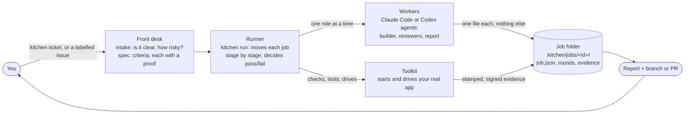
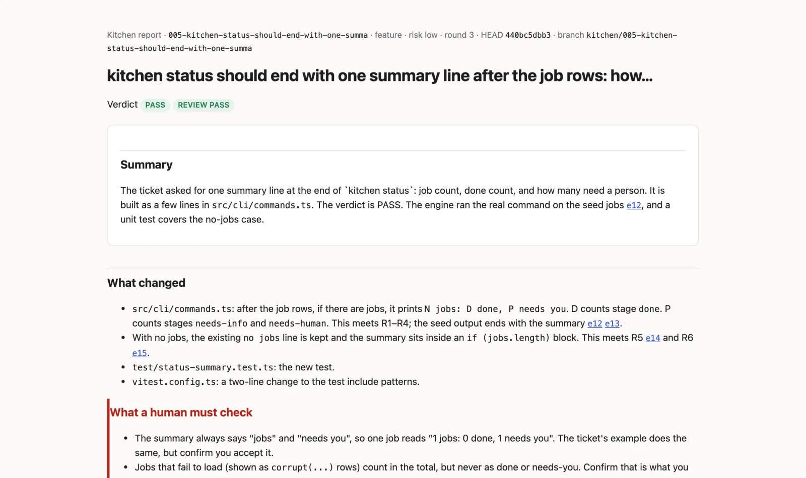
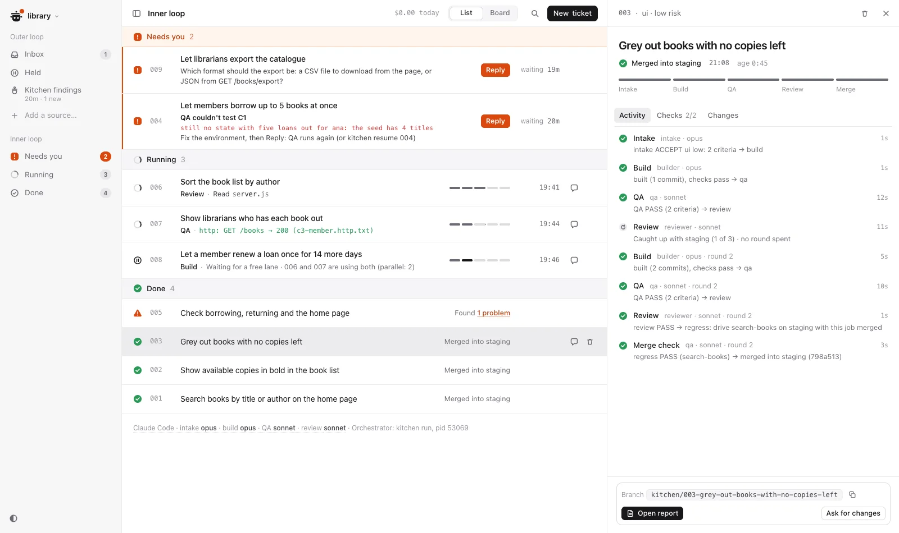

# Kitchen

**Tickets in, proven pull requests out.** Kitchen hands each ticket to a coding agent (Claude Code or Codex) for the judgment, and does everything else with plain code: it runs every check and proof itself, decides every pass or fail it can, commits, and writes a Report with the evidence. You read the Report and merge.

<picture>
  <source media="(prefers-color-scheme: dark)" srcset="docs/img/dashboard-board-dark.webp">
  
</picture>

<sub>A real `kitchen dashboard` on Kitchen's own dogfood repo: one job needs an answer, four are proven and ready to merge.</sub>

## Quick start

Three commands, in any git repo with a commit:

```sh
npm i -g devkitchen
kitchen init
kitchen ticket "Add lib/stats.js: print how many books and members seed.json holds" && kitchen run --detach && kitchen dashboard
```

<p align="center"></p>

<sub>Recorded from a real run on a fresh copy of the e-library fixture. The job's agent was Kitchen's free stand-in, so its 13 seconds are simulated; a real small ticket takes a few minutes and cents to a few tens of cents.</sub>

<details>
<summary><b>What each command prints</b></summary>

**`npm i -g devkitchen`** puts `kitchen` on your PATH (or put `npx devkitchen` wherever this page says `kitchen`).

```
added 21 packages in 751ms
```

**`kitchen init`** first checks what Kitchen needs, one line per tool, then sets up in seconds. It installs nothing and signs no one in: a ✗ comes with the command that fixes it on your OS, and a missing required tool stops it (exit 2) before it writes anything.

```
Checking what Kitchen needs…
  ✓ node     26.9.0
  ✓ git      2.39.5 · the repo has a commit
  ✓ claude   signed in (claude.ai)
  ✗ codex    not found (not needed: claude is ready)
  ✓ gh       signed in (optional: for GitHub pull requests)

Setting up Kitchen in e-library…
  ✓ Wrote kitchen.yaml     agent claude · 1 check from package.json
  ✓ Installed the skill    /kitchen for Claude Code and Codex · role skills: 6 of 8 found (kitchen skills)
  ✓ Updated .gitignore     18 Kitchen entries
  … Running test (npm test)…
  ✓ Ran the checks         test passed on main (d23dc73)                     0.3s
Done in 0.5s · no agent
Next: kitchen ticket "<what you want>"  then  kitchen run --detach
      commit kitchen.yaml, .gitignore and the skill folders when you like
      to have Kitchen drive your app as well: kitchen toolkit build (about 3–15 min)
```

**`kitchen ticket "…"`** files the ticket; **`kitchen run --detach`** works the queue in the background; **`kitchen dashboard`** serves every job on http://127.0.0.1:7357 (or `kitchen status` in the terminal):

```
ticket 001-add-lib-stats-js-node-lib-stats-js-print  "Add lib/stats.js: node lib/stats.js prints how many books…"  → intake
run detached: pid 48213, log ~/code/e-library/.kitchen/run.log

$ kitchen status
001-add-lib-stats-js-node-lib-stats-js-print Print the book and member counts   done   round 1/3  no PR  .kitchen/jobs/001-…/report.html
1 job: 1 done, 0 need you
```

Every question Kitchen asks shows the recommended answer first, and Enter takes it (`--yes` takes them all, for CI). If a step stops, it prints the one command that resumes it, and that command continues where it stopped. The whole walk-through, with every option: [docs/guide.md](docs/guide.md).

</details>

### From Claude Code or Codex

This repository is a plugin marketplace for both. In Claude Code:

```
/plugin marketplace add jcodebreaker/kitchen
/plugin install kitchen@kitchen
/kitchen set up Kitchen
```

In Codex: `codex plugin marketplace add jcodebreaker/kitchen`, then `codex plugin install kitchen@kitchen`. The `/kitchen` skill runs the CLI pinned (`npx -y devkitchen@0.1.0`, or a `kitchen` already on your PATH), relays the preflight's fix lines, and asks Kitchen's questions with the recommended answer first. After that, tell it what you want: "fix the empty state on the tasks list", "what's running?", "tell 004 to keep the diff small".

## How it works



- **Front desk.** Intake reads the ticket, rates its risk and writes the requirements; for anything above low risk a spec turns them into acceptance criteria, each with a proof Kitchen can run.
- **Runner.** `kitchen run` moves jobs through intake, build, gate (your checks), verify, review and report. Every pass or fail it can decide, it decides itself, from exit codes and outputs, never from an agent's say-so.
- **Workers.** The agents write code and judge what needs eyes. They hold no push rights and no tokens, and each writes one file that Kitchen copies.
- **Job folder.** Everything about a job lives in `.kitchen/jobs/<id>/`: its state, each round, the evidence (hash-chained and signed, so it can't be forged or reused) and the Report.
- **Toolkit.** The commands that start, drive and observe your app. Until you build it (`kitchen toolkit build`, 3 to 15 minutes, once), jobs are proven by your checks and tests, and their Reports say so.

## Example: a real job, end to end

From Kitchen's own dogfood repo. The ticket, as filed:

> kitchen status should end with one summary line after the job rows: how many jobs, how many are done, and how many need a person (needs-info or needs-human), e.g. '4 jobs: 2 done, 1 needs you'. With no jobs it keeps printing 'no jobs' and no summary.

What Kitchen did, in about 3 minutes and $0.51:

| step | what happened |
|---|---|
| Intake | rated it a low-risk feature; six requirements (R1–R6), one of them a negative (no summary with no jobs), and three criteria, each with a proof. Its first criteria failed Kitchen's own lint, so it asked; one line of feedback and it went on |
| Build, round 2 | the builder added the summary line and a test |
| Verify | C2 and C3 failed: the test file sat outside the folders vitest looked in. Back to build, with the failure |
| Build, round 3 | the builder fixed the test include; gate, drives and verify passed: C1, C2, C3 PASS, proven by Kitchen running the real command |
| Review, Report | no blocking findings; the Report below |

<picture>
  <source media="(prefers-color-scheme: dark)" srcset="docs/img/report-dark.webp">
  
</picture>

The Report opens with what a person must still check (here: "1 jobs" reads oddly, and corrupt jobs count in the total), then the requirements, the criteria and who decided each verdict, the evidence, the review notes and the cost. Click a job in the dashboard for the same story live:

<picture>
  <source media="(prefers-color-scheme: dark)" srcset="docs/img/dashboard-panel-dark.webp">
  
</picture>

## Concepts

| | |
|---|---|
| **Ticket** | One request for work: a prompt (`kitchen ticket`) or a GitHub issue with the `kitchen` label. |
| **Job** | One run of Kitchen on one Ticket, from intake to a ready pull request. Named like `003-show-open-count`. Lives in `.kitchen/jobs/<id>/`. |
| **Toolkit** | Your project's kit for starting, driving and observing your app: `.kitchen/toolkit/bin/dev` (start, reset, sign in, press, read, screenshot, http…) plus one file per feature describing how to reach it. It is the only way Kitchen touches your app. New commands come as their own Toolkit PR, proven on main. |
| **Verdict** | The outcome of driving the app against one acceptance criterion: PASS, FAIL, TOOLKIT-GAP (the Toolkit can't do something yet) or INCONCLUSIVE (counts as FAIL; retried once). Kitchen decides every mechanical one itself; an agent only judges what needs eyes (a layout, wording), and must cite evidence. |
| **Evidence** | What the proofs produced: screenshots, command output, each stamped with the commit it ran on, in a hash-chained, signed manifest. An agent can't forge or reuse it. |
| **Report** | One self-contained HTML page per job: what changed, why it is right, what you still have to check, and the Evidence. |

Risk decides how heavy the path is: low-risk tickets get inline criteria and a light review, high-risk ones (auth, payments, migrations) get a full spec, a security review, and are always marked for a human.

## Read more

| | |
|---|---|
| [docs/guide.md](docs/guide.md) | every step in full: the preflight, the checks `kitchen init` finds and how it runs them, tickets, the queue, Reports, building the Toolkit, the commands, the dashboard, retro |
| [docs/configuration.md](docs/configuration.md) | `kitchen.yaml`: every key and its default |
| [docs/safety.md](docs/safety.md) | the safety model (no push rights for agents, sandboxed proofs, signed evidence) and the known limitations of v0.1 |
| [docs/RELEASE.md](docs/RELEASE.md) | publishing the npm package and the plugin |
| `kitchen --help` · `kitchen <command> --help` | the commands, from the CLI |

Works with Claude Code or Codex, on macOS; Linux runs without the proof sandbox ([limitations](docs/safety.md#known-limitations-v01)). Status: v0.1.

## Role skills

Each role can be given proven outside skills (test-first building, bug diagnosis, a security review), quoted into its prompt as guidance. `kitchen skills` lists what is found for your agent tool.

<details>
<summary><b>Where skills come from, how they are used, and the registry</b></summary>

Each role can get proven outside skills as guidance: test-first building for a feature, bug diagnosis for a bug, a security review on a high-risk change (decision: `docs/adr/0014-role-skills.md` in the source repository). Kitchen ships one, `security-review` (adapted from Anthropic's MIT-licensed claude-code-security-review, see `NOTICE`), as the pinned default; the others it uses when they are installed, first found wins:

- **Your repository, as committed** on the job's base commit (read with git, never from a working tree): `.claude/skills/<name>/SKILL.md` for Claude Code, `.agents/skills/<name>/SKILL.md` for Codex. A `SKILL.md` committed as a symlink is refused. Nothing an agent writes in a job's worktree can become a skill.
- **Your own folders:** Claude Code `~/.claude/skills/<name>/SKILL.md`; Codex `~/.agents/skills` and `$CODEX_HOME/skills` (default `~/.codex/skills`).
- **Claude Code plugins** installed in `~/.claude/plugins/installed_plugins.json` and enabled in `~/.claude/settings.json` or the repo's `.claude/settings.json` / `settings.local.json`. A skill whose registry source is a plugin (`tdd` comes from `mattpocock-skills`) is taken from that plugin only; a skill two enabled plugins provide is ambiguous and not used.

`skills.use_installed: [security-review]` in `kitchen.yaml` takes your own install of a vendored skill instead of Kitchen's copy. A skill counts only as a non-empty `SKILL.md`, and never one its author marked for people only (`disable-model-invocation: true`). `kitchen init` and `kitchen skills` list what is there; before each agent role a job checks again for the roles still ahead. A **required** skill that is missing stops the job before that role runs (intake runs first, since it rates the risk), as `needs-human` with the skill, the tool and how to install it; install it and answer the job (`kitchen feedback <id> "installed"`); the round budget is not reset for it. A missing optional skill is skipped and logged. Kitchen never installs a skill.

Roles run sealed off (no settings, no slash commands), so Kitchen quotes each skill's `SKILL.md` (frontmatter removed, at most 12,000 characters each and 24,000 per role) under a "Skills" heading before the job's context, as guidance, each naming where it came from; the engine's own line about the output file ends every prompt. A skill never changes a role's tools, permissions or verdicts: code still decides. Each role run records in the ledger and `job.json` the skill's name, source, path, tool, the sha256 of its `SKILL.md` and how many characters reached the prompt; the Report has a "Skills used" table per role (with "cut at N of M" or "left out (cap)"); the dashboard shows them on each step; and a role that runs again with a changed skill (content or source) logs a warning.

A ticket may ask for more registry skills for the builder with a line `Kitchen-Skills: a, b` (outside code blocks): they are added as required, never removing one. A name the registry doesn't list, or an interactive skill, is refused and logged.

The registry, `skills/registry.json` (the table below is generated from it):

<!-- skills-registry:start (generated from skills/registry.json: npm run skills:readme) -->
| Role | Required | Picked by kind / surface / risk | Optional | Fallback if missing |
|---|---|---|---|---|
| builder | — | kind bug → `diagnosing-bugs`; kind feature/ui → `tdd`; kind chore → `codebase-design` | a registry skill named on the ticket's `Kitchen-Skills:` line (required) | the role prompt alone (today's behaviour) |
| intake | — | — | `domain-modeling` | the role prompt |
| spec | — | — | — | the role prompt |
| reviewer-code | — | — | `code-review`, `codebase-design` | the roles/_review.md checklist |
| reviewer-security | `security-review` (high risk) | security surface → `security-review` | — | none needed: Kitchen ships it |
| reviewer-ui | — | ui surface → `impeccable` | — | the reviewer-ui.md rubric; the Report says degraded |
| reviewer-ux | — | — | — | the role prompt |
| verifier | — | — | — | none: the verifier judges only what needs eyes |
| report | — | — | `humanizer` | the role prompt |

Never loaded: the interactive `grilling`, `grill-me`, `grill-with-docs`, `wizard`, `triage`, `ask-matt`, `to-questionnaire`, and any skill whose frontmatter says `disable-model-invocation: true`. Shipped with Kitchen (skills/vendor/, see NOTICE): `security-review`.
<!-- skills-registry:end -->

**Bench them before keeping them.** From a clone of Kitchen, run the same subset with and without skills, on the same machine (the skills installed for your agent tool are the ones measured), and compare correct rate, rounds and cost. Each side is paid agent runs, roughly $10–25 on the smoke subset:

```sh
kitchen skills                                                          # what the "with" side will load
kitchen bench smoke --tool claude --runs 3 --max-usd 25                 # with skills → bench/results/<date>-smoke-claude.md
kitchen bench smoke --tool claude --runs 3 --max-usd 25 --no-skills     # without → bench/results/<date>-smoke-claude-noskills.md
kitchen report --bench                                                  # both runs, one line each
```

A skill that doesn't raise the correct rate or lower cost or rounds beyond the bench's noise comes out of the registry.

</details>

## Developing Kitchen

`npm test`, `npm run typecheck` and `npm run lint` (Biome). The scripts under `spikes/` prove whole paths against copies of the fixtures; each one's README says what it needs. On macOS with Docker Desktop, give a Docker-using spike a scratch folder under `$HOME` (the default `spikes/<wave>/.work/` is), not `/tmp` or `/private/tmp`: Docker Desktop shares only some host folders with its VM, and a bind mount from elsewhere can fail or come up empty in the container.

## Credits

- The Toolkit's shape (launch, doctor, drive, evidence, cleanup, the feature map), the setup role (`roles/setup.md`) and the maintain role (`roles/maintainer.md`) are ported from pstack's `create-verification-skill` and `maintain-verification-skill`, MIT License, Copyright (c) 2026 Lauren Tan.
- Some ideas (a factory of agent stages with a ledger) come from zazencodes' software factory, which is GPL-licensed. **Ideas only: no code from it is in Kitchen.**

## License

Apache-2.0. See `LICENSE`; third-party notices are in `NOTICE`.
